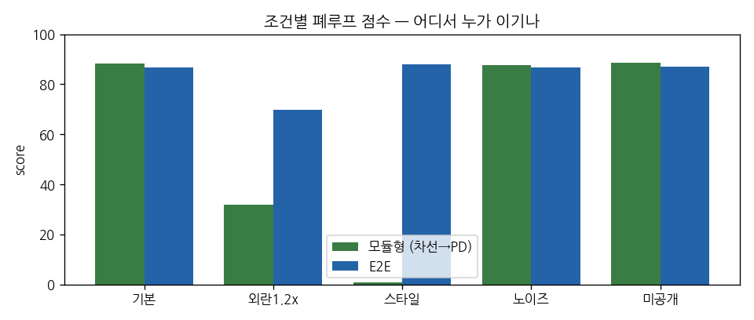

# 비교 리포트 — 202412330_이예림 (8주차)

## 표 1. 정책 × 조건 폐루프 score (공개 A/B/C, 시드 0)
| 정책 | 기본 | 외란1.2x | 스타일 | 노이즈 | 미공개 |
|---|---|---|---|---|---|
| modular | 88.4 | 32.0 | 0.9 | 87.5 | 88.5 |
| e2e | 86.7 | 69.9 | 88.0 | 86.7 | 87.0 |
| multitask λ=0.5 | 88.7 |  |  |  |  |
| frame-stack | 88.6 |  |  |  |  |

## 그래프 1
  <!-- 또는 cil_switch.png / speed_profile.png -->

## 해석 (5줄)
1. 어디서 누가 이겼나: 모듈형은 기본·노이즈·미공개 조건에서 E2E보다 높은 점수를 보였지만, 외란 1.2배와 스타일 변경에서는 E2E가 각각 69.9점과 88.0점으로 모듈형보다 우수했다.
2. 왜 (구조로 설명): 모듈형은 정해진 도로색을 기준으로 도로를 인식하므로 스타일 변경 시 마스크 오류가 상태 추정과 제어로 전파되어 점수가 0.9점까지 하락했다.
3. 예상과 다른 칸: 강의자료에서는 스타일 변경 시 E2E의 성능 하락을 예상했지만, 실제 점수는 기본 86.7점에서 88.0점으로 소폭 상승했다.
4. 내 챌린지 정책에 가져갈 것: 단일 프레임보다 주행 점수가 높고 평균 횡방향 오차와 조향 진동이 모두 감소한 프레임 스택을 적용하고자 한다.
5. 다음 실험: 단일 프레임과 프레임 스택을 시드 0·1·2 및 외란 1.2배 조건에서 비교하여 성능 개선이 일관적으로 나타나는지 확인하겠다.
