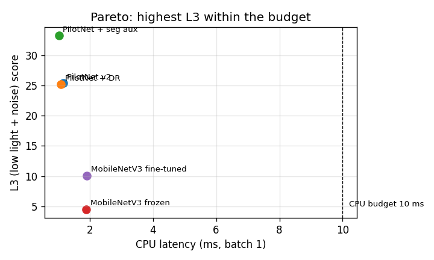

# 백본 실험 리포트— 202412330_이예림 (11주차)

## 모델 비교
| 모델 | 파라미터 수 | CPU 지연(ms) | ONNX(KB) | L1 | L3 | L2 |
|---|---:|---:|---:|---:|---:|---:|
| PilotNet v2 | 252219 | 1.16 | 988 | 86.7 | 25.4 | 17.3 |
| PilotNet + 랜덤화 | 252219 | 1.10 | 988 | 73.0 | 25.2 | 9.4 |
| PilotNet + 세그 보조 | 246749 | 1.03 | 966 | 86.5 | 33.3 | 10.5 |
| MobileNetV3 동결 | 984809 | 1.90 | 3856 | 57.9 | 4.5 | 7.7 |
| MobileNetV3 미세조정 | 984809 | 1.91 | 3856 | 87.0 | 10.1 | 8.9 |

## 성능–지연 그래프

## 결과 해석
1. **데이터 효과:** 랜덤화 후 L3는 25.4→25.2로 개선되지 않았고, L1·L2도 하락했다.
2. **표현 효과:** 세그 보조의 L3가 33.3으로 가장 높았으며, MobileNetV3는 랜덤화 PilotNet보다 낮았다.
3. **지연 예산:** 모든 모델이 10ms 미만이며, 이번 측정에서 세그 보조가 1.03ms로 가장 빨랐다.
4. **예상과 차이:** 랜덤화의 성능 향상이 없어 데이터 구성·학습량·시드 영향을 추가 확인할 필요가 있다.
5. **최종 선택:** 세그 보조를 선택하되, 기준보다 하락한 L2 복구 성능은 개선이 필요하다.

※ 평가 시드 0의 결과.
